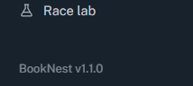
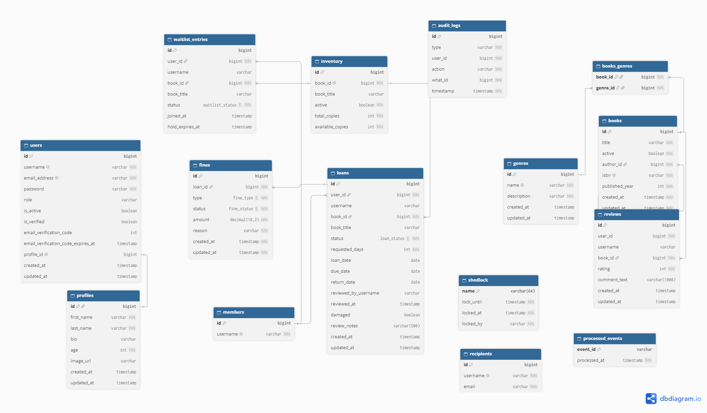
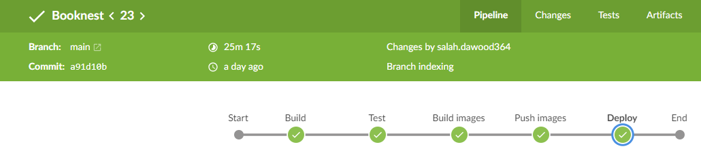
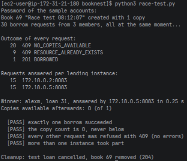

# BookNest

BookNest is a library platform: members browse the catalogue, borrow books, join waitlists and review
what they read; librarians manage the books, review returns, handle fines and manage accounts.

It is built as microservices that talk over REST and Kafka, run in Docker, are built, tested and
deployed by Jenkins, and run on AWS (EC2 + RDS) with logs in CloudWatch.

Current version: 1.1.0 (shown at the bottom of the side menu of the site, and on `/actuator/info`).



Live on AWS: http://54.158.44.134, every day from 09:00 to 18:00 (UTC+3). Outside those hours the server and
database are stopped to save cost (see [EventBridge Scheduler](docs/DEPLOYMENT.md#eventbridge-scheduler)).

| Document | What is in it |
|---|---|
| [docs/SERVICES.md](docs/SERVICES.md) | every service: responsibility, APIs, data, how it talks to the others |
| [docs/KAFKA.md](docs/KAFKA.md) | topics, events, producers and consumers, reliability |
| [docs/DEPLOYMENT.md](docs/DEPLOYMENT.md) | build, run locally, CI/CD, AWS setup and deployment |
| [docs/MONITORING.md](docs/MONITORING.md) | logs, health checks, CloudWatch |
| [docs/TESTING.md](docs/TESTING.md) | the Cucumber test suites and the race test |


## Main features

**Members**
* Register, verify the email with a code, log in, reset a forgotten password by email.
* Edit the profile and upload a profile picture.
* Browse and search the catalogue by title, author and genre.
* Borrow a book instantly (up to 5 at a time), return it, see the loan history and return record.
* Join the waitlist of a book with no free copies; the next returned copy is held for 24 hours for the first in line.
* Review books they have returned, pay fines.
* Live notifications in the browser and emails (loan events, holds, due tomorrow).

**Librarians**
* Manage books, authors and genres; set the number of copies.
* Review returned books for damage and add damage fines (late fines are automatic).
* See all loans, fines, waitlists and the audit log.
* Activate and deactivate accounts, and create other librarian accounts (new in 1.1.0).
* The Race lab page shows what happens when many members borrow the last copy at once.


## Architecture


* The browser only talks to api-gateway. It serves the pages of the frontend service and sends each
  `/api` and `/auth` call to the service that owns it.
* **Synchronous (REST):** browser → gateway → services, and catalog-service → lending-service
  (copy counts on the book pages, and whether a member returned a book before reviewing it).
* **Asynchronous (Kafka):** user-service and lending-service publish events; notification-service consumes
  them and sends the email and the live notification. Borrowing never waits for an email.
* All services use one PostgreSQL database `booknest`, but each service reads and writes only its own
  tables; anything else it needs comes through an API or an event.
* On AWS, two copies of lending-service run behind the nginx load balancer `lending-lb`, to show
  that the concurrency rules hold across instances. Locally there is one copy.

The production architecture on AWS has its own diagram in [docs/DEPLOYMENT.md](docs/DEPLOYMENT.md#production-architecture).


## Services

| Service | Port | Owns |
|---|---|---|
| api-gateway | 8080 (80 on AWS) | routing, the only public entrance |
| user-service | 8081 | accounts, login (JWT), email verification, password reset, profiles |
| catalog-service | 8082 | books, authors, genres, reviews |
| lending-service | 8083 | copies (stock), loans, waitlist and holds, fines, audit log, reminders |
| notification-service | 8084 | emails and live notifications (SSE) from Kafka events |
| frontend | 3000 (inside: 80) | the web pages (nginx) |
| Kafka | 9092 | events between services |
| PostgreSQL | 5433 locally | the `booknest` database (RDS on AWS) |

Every service's responsibility, endpoints, data and the reasons for the split: [docs/SERVICES.md](docs/SERVICES.md).
Swagger UI is on `/swagger-ui/index.html` of user-service (8081), catalog-service (8082) and lending-service (8083)
when they run from IntelliJ.




## Kafka

Kafka carries the notifications: services that change data publish an event and carry on, and
notification-service turns the events into emails and live notifications.

| Topic | Producer | Consumer | Events |
|---|---|---|---|
| `user-events` | user-service | notification-service | `UserRegistered`: a new account and its email address |
| `loan-events` | lending-service | notification-service | `LOAN_RETURNED`, `RETURN_REVIEWED`, `LOAN_CANCELLED`, `DUE_TOMORROW` |
| `waitlist-events` | lending-service | notification-service | `HOLD_READY`, `HOLD_EXPIRED` |
| `<topic>.DLT` | notification-service | none, kept for inspection | events that still failed after 3 retries |

Example event on `waitlist-events`:

```json
{
  "eventId": "b0d6e0c4-2f6b-4d0e-9a1e-3c7d5a9f8e21",
  "type": "HOLD_READY",
  "audience": "MEMBER",
  "userId": 12,
  "username": "janed",
  "loanId": null,
  "status": null,
  "message": "A copy of \"Dune\" is held for you for 24 hours. Claim it before it expires",
  "occurredAt": "2026-11-16T10:20:02"
}
```

When an event arrives, notification-service skips it if its `eventId` was already handled, sends the email
(for `MEMBER` events), then pushes the live notification. A failure is retried 3 times, 2 seconds apart, then
the event is moved to the dead-letter topic. Events are published only after the database commit.
Full details, reliability and limitations: [docs/KAFKA.md](docs/KAFKA.md).


## Technologies

* **Java 17, Spring Boot 4, Maven** (one multi-module project, one module per service), Lombok.
* **Spring Cloud Gateway** (api-gateway).
* **Spring Security + JWT** (JJWT): user-service signs the token, every service checks it with the shared secret.
* **Bucket4j:** rate limit on login and the other `/auth` calls, per IP.
* **Spring Data JPA / Hibernate, PostgreSQL** (Amazon RDS in production).
* **Apache Kafka** (KRaft, one broker) with Spring Kafka: retries, dead-letter topics, duplicate checks.
* **Spring Mail + Thymeleaf** templates, sent through Gmail SMTP.
* **Server-Sent Events** for live notifications.
* **ShedLock:** only one lending-service copy runs each scheduled job.
* **Springdoc OpenAPI / Swagger UI** on user, catalog and lending service.
* **Docker, Docker Compose, nginx** (frontend and lending load balancer).
* **Jenkins** (CI/CD), **Docker Hub** (images).
* **AWS:** EC2, RDS, IAM, Security Groups, CloudWatch Logs, EventBridge Scheduler.
* **Cucumber** (BDD) with JUnit Platform, H2 and embedded Kafka for the tests.


## Docker

Every service has a two-stage Dockerfile in its folder: a Maven + JDK 17 image builds the jar, then a small
Java 17 runtime image runs it as a non-root user. The frontend is served by nginx. Nothing but Docker has to be
installed on the machine.

| File | What it runs |
|---|---|
| [docker-compose.yml](docker-compose.yml) | everything on a PC: PostgreSQL, Kafka, pgAdmin, the 5 services and the frontend |
| [docker-compose.prod.yml](docker-compose.prod.yml) | the AWS server: Kafka and the services (2 lending-service copies behind nginx), images from Docker Hub, the database on RDS, logs to CloudWatch |
| [jenkins/docker-compose.yml](jenkins/docker-compose.yml) | Jenkins with Java 17 and the Docker CLI |

Run it locally:

```bash
cp .env.example .env
```

Fill in `.env` (see [Environment variables](#environment-variables)), then:

```bash
docker compose up --build
```

Open http://localhost:8080. The first start seeds sample books, a librarian (`librarian`) and members
(`johnd`, `janed`, `alexm`), all with the password you set as `SEED_PASSWORD`.
pgAdmin is on http://localhost:5050. Kafka starts with the rest; to start only Kafka:

```bash
docker compose up -d kafka
```

Build one image by hand (the build context is the project root, because the Dockerfiles need the parent pom):

```bash
docker build -f user-service/Dockerfile -t booknest-user-service .
```

The services find each other by name on the Compose network (`http://lending-service:8083`, `kafka:29092`,
`postgres:5432`), never `localhost`. To run a service from IntelliJ instead, start only what it needs with
`docker compose up -d postgres kafka frontend`. More in [docs/DEPLOYMENT.md](docs/DEPLOYMENT.md).


## Environment variables

Everything that differs between a PC and the server comes from environment variables; secrets are never in Git.
The `.env` files are git-ignored; the templates are [.env.example](.env.example) (PC) and
[.env.prod.example](.env.prod.example) (server).

| Variable | Used by | What |
|---|---|---|
| `DB_PASSWORD` | user, catalog, lending, notification | database password |
| `DB_URL` (PC) / `DB_HOST` (server) | the same four | database address; on AWS the RDS endpoint |
| `JWT_SECRET` | the same four | shared secret that signs and checks the login tokens |
| `EMAIL_USERNAME`, `EMAIL_PASSWORD` | user, notification | Gmail address and app password for emails |
| `PUBLIC_URL` | user | the site's address, used in email links |
| `SEED_PASSWORD` | user | password of the sample accounts, only used on an empty database |
| `KAFKA_BOOTSTRAP_SERVERS` | user, lending, notification | Kafka address (set by the Compose files) |
| `USER_SERVICE_URL`, `CATALOG_SERVICE_URL`, `LENDING_SERVICE_URL`, `NOTIFICATION_SERVICE_URL`, `FRONTEND_URL` | api-gateway (catalog also uses `LENDING_SERVICE_URL`) | where each service is (set by the Compose files) |
| `PGADMIN_EMAIL`, `PGADMIN_PASSWORD` | pgAdmin | its login |
| `VERSION`, `DOCKERHUB_USER` | server Compose file | which images to run; Jenkins writes `VERSION` on every deploy |
| `AWS_REGION` | server Compose file | region of the CloudWatch log group |

The Docker Hub token and the server's SSH key are Jenkins credentials, and the server gets its AWS permissions
from an IAM role, so there are no AWS keys anywhere.


## CI/CD

[Jenkinsfile](Jenkinsfile), run by Jenkins for every branch:

```
git push → Build → Test → Build images → Push images → Deploy → check the site
```

| Stage | What it does | Branches |
|---|---|---|
| Build | `./mvnw clean package -DskipTests`: compiles and packages every service | all |
| Test | `./mvnw test`: every service's Cucumber scenarios; reports kept on the build page | all |
| Build images | one image per service, tagged with the version, the version + commit, and `latest` (for example `1.1.0` and `1.1.0-6ceaf21`) | `main` |
| Push images | pushes them to Docker Hub | `main` |
| Deploy | over SSH: sets the new `VERSION` on the server, `docker compose pull` and `up --wait`, then checks that the site answers from outside | `main` |

Any failing step makes the build red and stops it, so nothing untested is deployed.




## AWS

| Service | Used for |
|---|---|
| EC2 (`m7i-flex.large`, Amazon Linux 2023, Elastic IP) | runs every container with Docker Compose |
| RDS for PostgreSQL (`db.t3.micro`, not public) | the `booknest` database |
| VPC security groups | only port 80 is public; SSH and pgAdmin only from one IP; the database only from the server |
| IAM | an admin user with MFA, a server role that may only write logs, a scheduler role that may only start and stop the server and the database |
| CloudWatch Logs | every container's log, in the group `/booknest/prod` |
| EventBridge Scheduler | starts the database and server in the morning and stops them in the evening |

The production architecture diagram, every setting and the screenshots: [docs/DEPLOYMENT.md](docs/DEPLOYMENT.md).


## Deployment

1. Set up AWS once: RDS, the EC2 server with Docker, the security groups and IAM roles
   ([Configure AWS](docs/DEPLOYMENT.md#5-configure-aws)).
2. Put `~/booknest/.env` on the server, filled in from [.env.prod.example](.env.prod.example).
3. Merge into `main`. Jenkins builds, tests, pushes the images and deploys them; nothing else is manual.
4. Verify: the Jenkins build is green, `docker compose -f docker-compose.prod.yml ps` on the server shows every
   container healthy, the site shows the new version, and `scripts/race-test.py` passes against the server.

Manual deploy, rollback to an older version and pgAdmin on the server: [Deploy](docs/DEPLOYMENT.md#6-deploy).
Logs, health checks and finding failures: [docs/MONITORING.md](docs/MONITORING.md).


## Concurrency

Two members can borrow the last copy of a book at the same moment, and with two lending-service copies the
two requests can even land on different servers. Without control both would read "1 copy left" and both get a loan.

**How it is prevented:** every stock change locks the book's inventory row in the database
(`@Lock(PESSIMISTIC_WRITE)`, `SELECT ... FOR UPDATE`) inside one transaction. The second request waits for the
first to commit, then sees 0 copies and gets `409 NO_COPIES_AVAILABLE`. Because the database holds the lock,
this works for any number of threads and any number of service instances (a Java `synchronized` would not).
Locks are always taken member first, then book, so requests cannot deadlock.

| Situation | Without control | Prevented by |
|---|---|---|
| Many members borrow the last copy | more loans than copies | lock on the inventory row |
| One member borrows many books at once | more than 5 loans | lock on the member row first |
| Same fine paid twice | paid twice | lock on the fine |
| Two librarians review the same return | copy put back twice | lock on the loan |
| A walk-in takes a copy held for the waitlist | first in line loses it | held copies are not counted as free |
| A hold expires while the member claims it | copy lost or offered twice | lock on the entry and the book |
| Both lending copies run the same scheduled job | reminders sent twice, holds expired twice | ShedLock (lock row in the `shedlock` table) |

Rule that always holds for a book: `total copies = copies on the shelf + copies on loan + copies held for the waitlist`.
Events (and so emails) are published only after the transaction commits.

Shown by Cucumber scenarios (threads started together with a latch) and by `scripts/race-test.py`, which fires
borrows at the deployed server through the load balancer:




## Testing

Every service has its own Cucumber (BDD) suite: Gherkin feature files run against the real Spring Boot application
on a random port, with an in-memory H2 database, an embedded Kafka broker, and small fake servers in place of the
other services.

| Service | Scenarios | Covers |
|---|---|---|
| api-gateway | 31 | routing, passing the token and caller IP on, a service being down, health and version |
| user-service | 51 | registration, login, email verification, password reset, profiles, administration, creating librarians, Kafka events |
| catalog-service | 29 | books, reviews, calls to lending-service (down, slow, failing), health |
| lending-service | 75 | borrowing, returns, waitlist and holds, concurrency, ShedLock with two schedulers, Kafka events, configuration |
| notification-service | 20 | emails from events, duplicates, retries, dead-letter topic, live notifications |

```bash
./mvnw test
```

Jenkins runs them on every push. The deployed system is checked by the Deploy stage (every container healthy, the
site answering) and by `scripts/race-test.py` against the server. The unit tests of the earlier versions were
rewritten as Cucumber scenarios, so the same cases are still covered. Details: [docs/TESTING.md](docs/TESTING.md).


## Planning

From 8 to 19 November 2026, one branch and pull request per step.

| Day | Date      | Work | Status |
|---|-----------|---|---|
| 1 | 8 Nov     | Split the application into modules; api-gateway; user-service, catalog-service and lending-service; each service's own data | done (PRs #15–#19) |
| 2 | 9 Nov     | Kafka: notification-service, `UserRegistered` and lending events, emails and live notifications | done (PR #20) |
| 3 | 10 Nov    | Kafka reliability: retries, dead-letter topics, duplicate checks; first Cucumber suite | done (PRs #21, #22) |
| 4 | 11 Nov    | Dockerfiles, Docker Compose, frontend as its own service; Jenkins pipeline | done (PRs #23, #24) |
| 5–7 | 12–14 Nov | AWS: RDS, EC2, security groups, IAM; production Compose file; first deploy | done (PR #25) |
| 8 | 15 Nov    | Jenkins Deploy stage, CloudWatch logs, EventBridge schedules; ShedLock; two lending instances behind nginx; Cucumber for every service | done (PRs #26–#28) |
| 9 | 16 Nov    | Version 1.1.0 "librarian creates librarian" released through the pipeline; pgAdmin on the server | done (PR #29) |
| 10 | 17 Nov    | Documentation, AWS screenshots, ERD; code review and cleanup | done (PRs #30, #31) |
| 11–12 | 18–19 Nov | Final checks, README completed, presentation | done |


## User stories

The stories from the earlier versions are on the
[Trello board](https://trello.com/invite/b/6ac5e7834bebef07fc444288/ATTIdecc791734b4cd6ac191843744f7f8216F35C90A/booknest).
New stories for running BookNest in production:

* As a system administrator, I want each service to be built, deployed and restarted on its own, so that a change
  to one part does not mean rebuilding everything.
* As a system administrator, I want every push to `main` to be built, tested and deployed automatically, so that a
  release needs no manual steps and a failing test stops it.
* As a system administrator, I want every image tagged with its version and commit, so that I know exactly what is
  running and can roll back to an earlier version.
* As a system administrator, I want containers to restart by themselves and the deploy to wait until every service
  is healthy, so that common failures recover and a broken release is noticed.
* As a system administrator, I want the logs of every container in one place (CloudWatch), so that I can find
  why something failed without logging in to the server.
* As a system administrator, I want the database to be unreachable from the internet and secrets kept out of Git,
  so that the data stays safe.
* As the library, I want the server and database to stop at night, so that the cloud bill stays low.
* As a member, I want my borrow to be handled correctly even when many members borrow the same book at once and
  several servers are running, so that a copy is never lent twice.
* As a member, I want my emails and live notifications to arrive even if the notification service was briefly
  down, so that I do not miss that my hold is ready.
* As a librarian, I want to create other librarian accounts, so that new staff can start without a developer's help.


## Challenges

* **Splitting the data.** Lending needed to lock a member row for the loan limit, but users moved to
  user-service, so lending keeps its own small `members` table (id and username), created from the
  JWT on a member's first lending request.
* **Two lending instances.** The scheduled jobs ran twice, until ShedLock was added; the load balancer
  had to find replaced containers again, so nginx re-resolves the service name every 10 seconds.
* **Small servers.** The first EC2 instance (t3.micro, 1 GB) ran out of memory with Kafka and five JVMs;
  it now runs on m7i-flex.large with a memory limit per container.
* **Kafka tests.** Events arrive later than the HTTP answer, so the Cucumber steps wait for them with a
  timeout instead of checking right away.


## Unsolved problems

* **One shared database.** Every service uses the same `booknest` database. Each one only touches its own tables,
  but the database itself is not split per service.
* **Lost events when Kafka is down.** If Kafka cannot be reached when an event is published, the action still
  succeeds but that notification is lost (no outbox table).
* **One Kafka broker.** There is no replication, so losing the broker's disk loses events not yet handled.
* **Dead-letter events are not replayed.** They are kept in the `.DLT` topics for inspection only.
* **Book titles copied into lending are not updated.** Renaming a book does not change the title stored with its stock and loans.
* **Seeding race on an empty database.** When both lending-service copies start on an empty database at the same
  moment, both try to seed the sample members; one fails with a duplicate key and the data still ends up correct.
* **Short downtime on deploy.** Containers are replaced in place, so the site is briefly unavailable during a release.
* **Plain HTTP.** The site has no domain name or HTTPS yet.


## Future improvements

* Separate databases (or schemas) per service instead of one shared database.
* A domain name with HTTPS in front of the gateway.
* Jenkins on a server instead of a laptop, triggered by GitHub webhooks.
* Run the tests on PostgreSQL (Testcontainers) instead of H2.
* An outbox table so no event is lost when Kafka is down, and three Kafka brokers.
* Rolling deploys so a release has no downtime.


## Credits & external resources

| Resource | URL | Used for |
|---|---|---|
| Spring Boot reference | https://docs.spring.io/spring-boot/ | services, configuration, profiles, Actuator, build info |
| Spring Cloud Gateway | https://docs.spring.io/spring-cloud-gateway/reference/ | the api-gateway routes |
| Spring for Apache Kafka | https://docs.spring.io/spring-kafka/reference/ | producers, listeners, error handler, dead-letter topics, embedded Kafka in tests |
| Apache Kafka documentation | https://kafka.apache.org/documentation/ | topics, partitions, consumer groups, KRaft |
| Apache Kafka Docker image | https://hub.docker.com/r/apache/kafka | running Kafka in Docker |
| Spring Security | https://docs.spring.io/spring-security/reference/ | JWT filters and role checks in every service |
| springdoc-openapi | https://springdoc.org/ | Swagger UI |
| ShedLock | https://github.com/lukas-krecan/ShedLock | one scheduled job run across two instances |
| Bucket4j | https://bucket4j.com/ | rate limiting the login calls |
| Docker documentation | https://docs.docker.com/ | Dockerfiles, multi-stage builds |
| Docker Compose | https://docs.docker.com/compose/ | the local and server Compose files, health checks, profiles |
| Docker awslogs driver | https://docs.docker.com/engine/logging/drivers/awslogs/ | sending container logs to CloudWatch |
| nginx upstream module | https://nginx.org/en/docs/http/ngx_http_upstream_module.html | the lending-service load balancer |
| Jenkins Pipeline | https://www.jenkins.io/doc/book/pipeline/ | the Jenkinsfile |
| Amazon EC2 | https://docs.aws.amazon.com/ec2/ | the server, Elastic IP, security groups |
| Amazon RDS | https://docs.aws.amazon.com/rds/ | the PostgreSQL database |
| AWS IAM | https://docs.aws.amazon.com/iam/ | the admin user and the roles |
| Amazon CloudWatch Logs | https://docs.aws.amazon.com/cloudwatch/ | log groups, Logs Insights, Live Tail |
| Amazon EventBridge Scheduler | https://docs.aws.amazon.com/scheduler/ | starting and stopping the server and database |
| Cucumber | https://cucumber.io/docs/ | Gherkin features and Spring integration |
| Mermaid | https://mermaid.js.org/ | the diagrams in the docs |
| dbdiagram.io | https://dbdiagram.io/ | the ERD |
| Trello | https://trello.com/ | user stories |
| Claude | https://claude.ai | planning, explanations, code review, the frontend, and help with Docker, Jenkins and AWS |
| Google AI | https://ai.google | general searches about related topics |

Thanks to my lead instructor [Saad](https://www.linkedin.com/in/saad-iqbal-6623a262/) and instructor associates
[Maryam](https://www.linkedin.com/in/bymrmak/) and [Zainab](https://www.linkedin.com/in/zainab-al-zaimoor/) from General Assembly (GA)
for their guidance and technical help.
