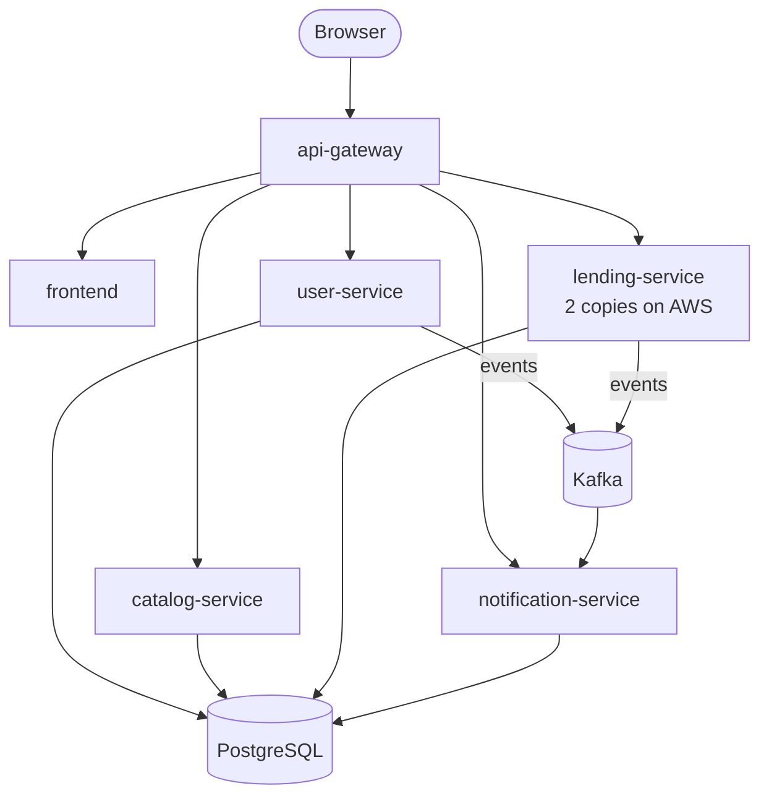

# BookNest

BookNest is a library platform: members browse the catalogue, borrow books, join waitlists and review
what they read; librarians manage the books, review returns, handle fines and manage accounts.

It is built as microservices that talk over REST and Kafka, run in Docker, are built, tested and
deployed by Jenkins, and run on AWS (EC2 + RDS) with logs in CloudWatch.

Current version: 1.1.0 (shown at the bottom of the side menu of the site, and on `/actuator/info`).

| Document | What is in it |
|---|---|
| [docs/SERVICES.md](docs/SERVICES.md) | every service: responsibility, APIs, data, how it talks to the others |
| [docs/KAFKA.md](docs/KAFKA.md) | topics, events, producers and consumers, reliability |
| [docs/DEPLOYMENT.md](docs/DEPLOYMENT.md) | build, run locally, CI/CD, AWS setup and deployment |
| [docs/MONITORING.md](docs/MONITORING.md) | logs, health checks, CloudWatch |
| [docs/TESTING.md](docs/TESTING.md) | the Cucumber test suites and the race test |


## Main features

**Members**
* Register, verify the email with a code, log in, reset a forgotten password by email.
* Edit the profile and upload a profile picture.
* Browse and search the catalogue by title, author and genre.
* Borrow a book instantly (up to 5 at a time), return it, see the loan history and return record.
* Join the waitlist of a book with no free copies; the next returned copy is held for 24 hours for the first in line.
* Review books they have returned, pay fines.
* Live notifications in the browser and emails (loan events, holds, due tomorrow).

**Librarians**
* Manage books, authors and genres; set the number of copies.
* Review returned books for damage and add damage fines (late fines are automatic).
* See all loans, fines, waitlists and the audit log.
* Activate and deactivate accounts, and create other librarian accounts (new in 1.1.0).
* The Race lab page shows what happens when many members borrow the last copy at once.


## Architecture



* The browser only talks to api-gateway. It serves the pages of the frontend service and sends each
  `/api` and `/auth` call to the service that owns it.
* **Synchronous (REST):** browser → gateway → services, and catalog-service → lending-service
  (copy counts on the book pages, and whether a member returned a book before reviewing it).
* **Asynchronous (Kafka):** user-service and lending-service publish events; notification-service consumes
  them and sends the email and the live notification. Borrowing never waits for an email.
* All services use one PostgreSQL database `booknest`, but each service reads and writes only its own
  tables; anything else it needs comes through an API or an event.
* On AWS, two copies of lending-service run behind the nginx load balancer `lending-lb`, to show
  that the concurrency rules hold across instances. Locally there is one copy.

| Service | Port | Owns |
|---|---|---|
| api-gateway | 8080 (80 on AWS) | routing, the only public entrance |
| user-service | 8081 | accounts, login (JWT), email verification, password reset, profiles |
| catalog-service | 8082 | books, authors, genres, reviews |
| lending-service | 8083 | copies (stock), loans, waitlist and holds, fines, audit log, reminders |
| notification-service | 8084 | emails and live notifications (SSE) from Kafka events |
| frontend | 3000 (inside: 80) | the web pages (nginx) |
| Kafka | 9092 | events between services |
| PostgreSQL | 5433 locally | the `booknest` database (RDS on AWS) |


## Technologies

* **Java 17, Spring Boot 4, Maven** (one multi-module project, one module per service), Lombok.
* **Spring Cloud Gateway** (api-gateway).
* **Spring Security + JWT** (JJWT): user-service signs the token, every service checks it with the shared secret.
* **Bucket4j:** rate limit on login and the other `/auth` calls, per IP.
* **Spring Data JPA / Hibernate, PostgreSQL** (Amazon RDS in production).
* **Apache Kafka** (KRaft, one broker) with Spring Kafka: retries, dead-letter topics, duplicate checks.
* **Spring Mail + Thymeleaf** templates, sent through Gmail SMTP.
* **Server-Sent Events** for live notifications.
* **ShedLock:** only one lending-service copy runs each scheduled job.
* **Springdoc OpenAPI / Swagger UI** on user, catalog and lending service.
* **Docker, Docker Compose, nginx** (frontend and lending load balancer).
* **Jenkins** (CI/CD), **Docker Hub** (images).
* **AWS:** EC2, RDS, IAM, Security Groups, CloudWatch Logs, EventBridge Scheduler.
* **Cucumber** (BDD) with JUnit Platform, H2 and embedded Kafka for the tests.


## Run it locally

Needs only Docker Desktop (Java, Maven, PostgreSQL and Kafka all run inside containers).

```bash
cp .env.example .env
```

Fill in `.env` (database password, JWT secret, the Gmail address and app password for emails), then:

```bash
docker compose up --build
```

Open http://localhost:8080. The first start seeds sample books, a librarian (`librarian`) and members.
pgAdmin is on http://localhost:5050.

To run a service from IntelliJ instead, start only what it needs with
`docker compose up -d postgres kafka frontend`. More in [docs/DEPLOYMENT.md](docs/DEPLOYMENT.md).


## CI/CD and AWS in short

```
git push → Jenkins: Build → Test (Cucumber) → Build images → Push to Docker Hub → Deploy to EC2 → check the site
```

* Jenkins builds and tests every branch; on `main` it also builds the images, tags them with the version and
  commit (for example `1.1.0-6ceaf21`), pushes them to Docker Hub and deploys them to the EC2 server.
* EC2 runs the containers with `docker-compose.prod.yml`; the database is Amazon RDS, reachable only from the server.
* Container logs go to CloudWatch Logs; EventBridge Scheduler starts and stops EC2 and RDS on a timetable.

Details in [docs/DEPLOYMENT.md](docs/DEPLOYMENT.md) and [docs/MONITORING.md](docs/MONITORING.md).


## Concurrency

Two members can borrow the last copy of a book at the same moment, and with two lending-service copies the
two requests can even land on different servers. Without control both would read "1 copy left" and both get a loan.

**How it is prevented:** every stock change locks the book's inventory row in the database
(`@Lock(PESSIMISTIC_WRITE)`, `SELECT ... FOR UPDATE`) inside one transaction. The second request waits for the
first to commit, then sees 0 copies and gets `409 NO_COPIES_AVAILABLE`. Because the database holds the lock,
this works for any number of threads and any number of service instances (a Java `synchronized` would not).
Locks are always taken member first, then book, so requests cannot deadlock.

| Situation | Without control | Prevented by |
|---|---|---|
| Many members borrow the last copy | more loans than copies | lock on the inventory row |
| One member borrows many books at once | more than 5 loans | lock on the member row first |
| Same fine paid twice | paid twice | lock on the fine |
| Two librarians review the same return | copy put back twice | lock on the loan |
| A walk-in takes a copy held for the waitlist | first in line loses it | held copies are not counted as free |
| A hold expires while the member claims it | copy lost or offered twice | lock on the entry and the book |
| Both lending copies run the same scheduled job | reminders sent twice, holds expired twice | ShedLock (lock row in the `shedlock` table) |

Rule that always holds for a book: `total copies = copies on the shelf + copies on loan + copies held for the waitlist`.
Events (and so emails) are published only after the transaction commits.

Shown by Cucumber scenarios (threads started together with a latch) and by `scripts/race-test.py`, which fires
borrows at the deployed server through the load balancer. See [docs/TESTING.md](docs/TESTING.md).


## User stories

[Trello board](https://trello.com/invite/b/6ac5e7834bebef07fc444288/ATTIdecc791734b4cd6ac191843744f7f8216F35C90A/booknest)


## Challenges

* **Splitting the data.** Lending needed to lock a member row for the loan limit, but users moved to
  user-service, so lending keeps its own small `members` table (id and username), created from the
  JWT on a member's first lending request.
* **Two lending instances.** The scheduled jobs ran twice, until ShedLock was added; the load balancer
  had to find replaced containers again, so nginx re-resolves the service name every 10 seconds.
* **Small servers.** The first EC2 instance (t3.micro, 1 GB) ran out of memory with Kafka and five JVMs;
  it now runs on m7i-flex.large with a memory limit per container.
* **Kafka tests.** Events arrive later than the HTTP answer, so the Cucumber steps wait for them with a
  timeout instead of checking right away.


## Future improvements

* Separate databases (or schemas) per service instead of one shared database.
* A domain name with HTTPS in front of the gateway.
* Jenkins on a server instead of a laptop, triggered by GitHub webhooks.
* Run the tests on PostgreSQL (Testcontainers) instead of H2.


## Credits & external resources

* **Claude** - [https://claude.ai](https://claude.ai) - planning, explanations, code review, the frontend,
  and help with Docker, Jenkins and AWS.
* **Google AI** - general searches about related topics.

Thanks to my lead instructor [Saad](https://www.linkedin.com/in/saad-iqbal-6623a262/) and instructor associates
[Maryam](https://www.linkedin.com/in/bymrmak/) and [Zainab](https://www.linkedin.com/in/zainab-al-zaimoor/) from General Assembly (GA)
for their guidance and technical help.
