# Deployment

How BookNest is built, run on a PC, delivered by Jenkins and deployed to AWS.

1. [Production architecture](#production-architecture)
2. [Build the application](#1-build-the-application)
3. [Build the Docker images](#2-build-the-docker-images)
4. [Run locally](#3-run-locally)
5. [Kafka](#4-kafka)
6. [Configure AWS](#5-configure-aws)
7. [Deploy](#6-deploy)
8. [Verify the deployment](#7-verify-the-deployment)


## Production architecture

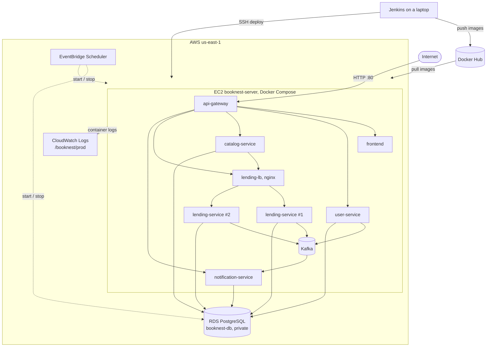

* One EC2 server (`m7i-flex.large`, 2 vCPU, 8 GB, Amazon Linux 2023) runs every container with
  `docker-compose.prod.yml`. Only port 80 (the gateway) is open to the internet.
* The database is Amazon RDS for PostgreSQL. It has no public address and only accepts connections from the
  server's security group.
* lending-service runs as two containers behind the nginx load balancer `lending-lb`, to show the
  concurrency rules across instances.
* Every container sends its logs to CloudWatch Logs.
* EventBridge Scheduler starts the database and server in the morning and stops them at night, to save cost.
* Jenkins builds and tests every push, pushes the images to Docker Hub, and deploys `main` to the server over SSH.

Why one EC2 server with Docker Compose instead of Kubernetes (EKS) or ECS: it is the simplest setup that runs
the whole system, the same Compose file style is used locally, and it fits a course budget. The cost is that
the server is a single point of failure.


## 1. Build the application

BookNest is one Maven multi-module project (`pom.xml` at the root, one module per service). Needs JDK 17;
the Maven wrapper downloads Maven.

```bash
./mvnw clean package -DskipTests
```

Each service's jar ends up in `<service>/target/`. To build and run the tests too:

```bash
./mvnw clean package
```


## 2. Build the Docker images

Every service has a two-stage Dockerfile in its folder:

1. `maven:3.9-eclipse-temurin-17` builds the jar (the poms are copied first, so downloaded libraries are cached).
2. `eclipse-temurin:17-jre` runs it as a non-root user `booknest`, with `EXPOSE` of the service port and
   `ENTRYPOINT ["java", "-jar", "app.jar"]`.

The frontend's Dockerfile copies the HTML, CSS and JS into `nginx:alpine`.

The build context is the project root (the Dockerfiles need the parent pom):

```bash
docker build -f user-service/Dockerfile -t booknest-user-service .
```

`docker compose up --build` builds all of them at once. Nothing but Docker has to be installed on the machine.

Images on Docker Hub are named `<dockerhub-user>/booknest-<service>` and get three tags on every build of `main`:

| Tag | Example | Use |
|---|---|---|
| version from the pom | `1.1.0` | the release |
| version + commit | `1.1.0-6ceaf21` | exactly which commit the image came from; this is what the server runs |
| `latest` | `latest` | convenience only |


## 3. Run locally

Needs only Docker Desktop.

```bash
cp .env.example .env
```

Fill in `.env`:

| Key | What |
|---|---|
| `DB_PASSWORD` | password for the local PostgreSQL container (any value) |
| `JWT_SECRET` | a long random Base64 string, at least 32 characters; shared by every service |
| `EMAIL_USERNAME`, `EMAIL_PASSWORD` | a Gmail address and an app password, for the emails |
| `PUBLIC_URL` | optional, the address used in email links (default `http://localhost:8080`) |
| `SEED_PASSWORD` | password of the sample accounts created on the first start |
| `PGADMIN_EMAIL`, `PGADMIN_PASSWORD` | login for pgAdmin |

Then:

```bash
docker compose up --build
```

| Address | What |
|---|---|
| http://localhost:8080 | BookNest (through the gateway) |
| http://localhost:5050 | pgAdmin, with the BookNest database already listed |
| localhost:5433 | PostgreSQL (5433 so it does not clash with a PostgreSQL installed on the PC) |
| localhost:9092 | Kafka |

The services start in order: PostgreSQL and Kafka first, then the services once they are healthy, then the
gateway. They reach each other by service name on the Compose network (`http://lending-service:8083`,
`kafka:29092`, `postgres:5432`), never `localhost`. On the first start each service creates its tables and
seeds sample data: books, a librarian `librarian` and the members `johnd`, `janed` and `alexm`, all with the
password from `SEED_PASSWORD`.

Stop with `docker compose down` (add `-v` to also delete the database).

### Running a service from IntelliJ

Start only the infrastructure in Docker, then run the services from IntelliJ (profile `dev`):

```bash
docker compose up -d postgres kafka frontend
```

Each run configuration needs `DB_PASSWORD`, `JWT_SECRET` (the same everywhere), the email keys for user- and
notification-service, and `DB_URL=jdbc:postgresql://localhost:5433/booknest` because the Docker PostgreSQL is on 5433.


## 4. Kafka

Kafka is part of both Compose files, so `docker compose up` starts it; there is nothing to install. It is one
`apache/kafka:4.1.0` broker in KRaft mode (no ZooKeeper), with its data in the `kafka-data` volume.

| Where | Address the services use |
|---|---|
| inside Docker locally | `kafka:29092` |
| from IntelliJ on the PC | `localhost:9092` (the default) |
| on the server | `kafka:9092` |

The services read it from `KAFKA_BOOTSTRAP_SERVERS`. The topics are created on startup. To start only Kafka:

```bash
docker compose up -d kafka
```

To list the topics:

```bash
docker compose exec kafka /opt/kafka/bin/kafka-topics.sh --bootstrap-server localhost:9092 --list
```

Topics, events and reliability: [KAFKA.md](KAFKA.md).


## 5. Configure AWS

Everything is in region `us-east-1`. These steps were done once, in the AWS console.

### IAM

| Identity | Permissions | Used by |
|---|---|---|
| `booknest-admin` user (group `booknest-admins`), with MFA | `AdministratorAccess` | the person managing the account; the root user is only for account-level tasks |
| `booknest-ec2-role` (attached to the server) | `CloudWatchAgentServerPolicy`: write logs to CloudWatch | Docker's `awslogs` log driver on the server |
| `booknest-scheduler-role` | inline policy `booknest-start-stop`: only `ec2:StartInstances`/`StopInstances` on the BookNest server and `rds:StartDBInstance`/`StopDBInstance` on `booknest-db` | EventBridge Scheduler |

The server gets its AWS permissions from its role, so no AWS access keys exist anywhere, on the server or in the code.

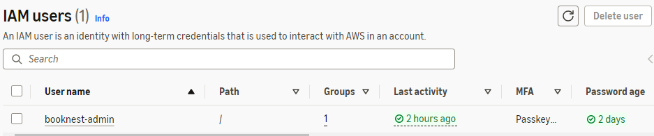

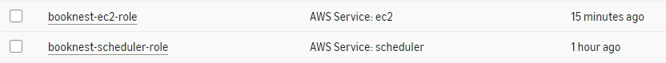

### RDS (database)

| Setting | Value |
|---|---|
| Engine | PostgreSQL |
| Identifier | `booknest-db` |
| Class / storage | `db.t3.micro`, 20 GB gp3, storage autoscaling off |
| Public access | No |
| Security group | `booknest-db-sg`: PostgreSQL 5432 only from the server's security group |

The `booknest` database was created once from the server (RDS cannot be reached from anywhere else):

```bash
docker run --rm -it postgres:17 psql "host=<rds-endpoint> port=5432 user=postgres dbname=postgres sslmode=require" -c "CREATE DATABASE booknest;"
```

The services create their tables on first start.

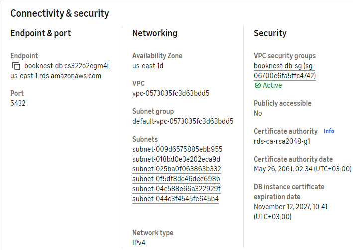

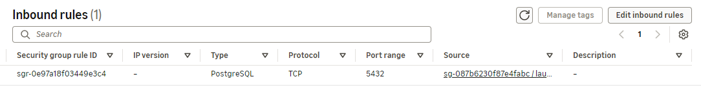

### EC2 (server)

| Setting | Value |
|---|---|
| Name | `booknest-server` |
| Image | Amazon Linux 2023 |
| Type | `m7i-flex.large` (a `t3.micro` with 1 GB ran out of memory) |
| Storage | 20 GB gp3 |
| Key pair | `booknest-key` (the private key stays on the PC, in `~/.ssh`) |
| IAM role | `booknest-ec2-role` |
| Address | an Elastic IP, so it stays the same after every stop and start |

The server's security group, inbound:

| Port | Source | Why |
|---|---|---|
| 80 (HTTP) | anywhere | the site |
| 22 (SSH) | my IP only | administration and the Jenkins deploy |
| 22 (SSH) | AWS's EC2 Instance Connect range for us-east-1 | logging in from the browser, in the AWS console |
| 5050 | my IP only | pgAdmin, only when it is started |

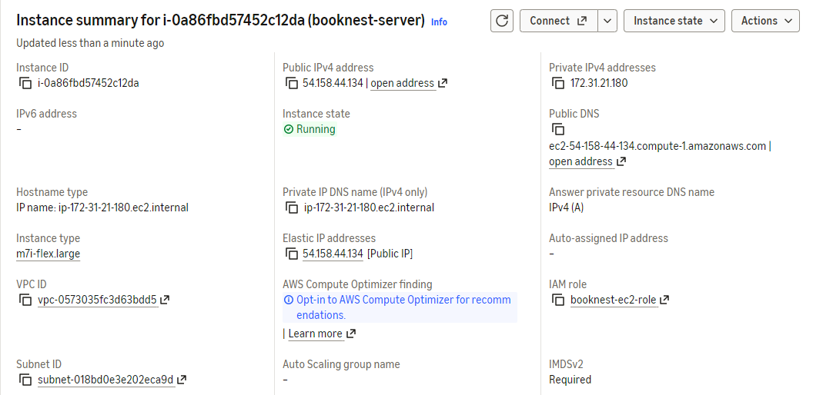

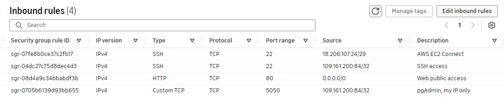

Docker was installed by the instance's user data on first boot:

```bash
#!/bin/bash
dnf install -y docker
systemctl enable --now docker
usermod -aG docker ec2-user
mkdir -p /usr/local/lib/docker/cli-plugins
curl -fsSL "https://github.com/docker/compose/releases/latest/download/docker-compose-linux-x86_64" -o /usr/local/lib/docker/cli-plugins/docker-compose
chmod +x /usr/local/lib/docker/cli-plugins/docker-compose
mkdir -p /home/ec2-user/booknest && chown ec2-user /home/ec2-user/booknest
```

The server's settings live in `~/booknest/.env` on the server only (template: [.env.prod.example](../.env.prod.example)):
`DB_HOST` (the RDS endpoint), `DB_PASSWORD`, `JWT_SECRET`, the email keys, `PUBLIC_URL`, `DOCKERHUB_USER`,
`AWS_REGION`, the pgAdmin login, `SEED_PASSWORD` (only used on an empty database), and `VERSION` (written by Jenkins on each deploy).

### CloudWatch Logs

The log group `/booknest/prod` was created in `us-east-1`. Every container in `docker-compose.prod.yml` uses the
`awslogs` driver, with one stream per container. See [MONITORING.md](MONITORING.md).

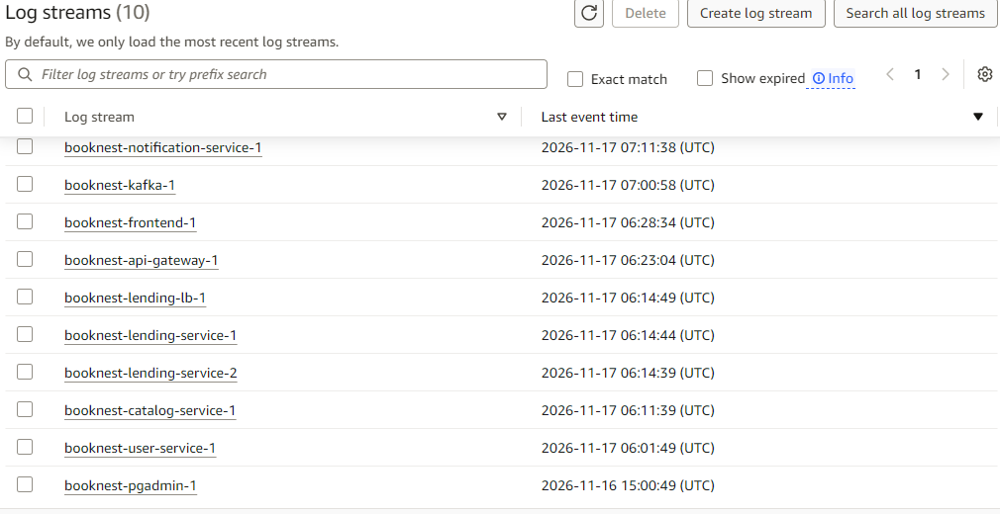

### EventBridge Scheduler

Four schedules, all using `booknest-scheduler-role` and the time zone UTC+3. The database starts 30 minutes
before the server, so it is ready when the services connect, and stops 10 minutes after it:

| Schedule | Action | Time (UTC+3) | Cron |
|---|---|---|---|
| `booknest-db-start` | RDS `StartDBInstance` `{"DbInstanceIdentifier": "booknest-db"}` | 08:30 | `30 8 * * ? *` |
| `booknest-server-start` | EC2 `StartInstances` `{"InstanceIds": ["i-..."]}` | 09:00 | `0 9 * * ? *` |
| `booknest-server-stop` | EC2 `StopInstances` | 18:00 | `0 18 * * ? *` |
| `booknest-db-stop` | RDS `StopDBInstance` | 18:10 | `10 18 * * ? *` |

So the site is online every day from 09:00 to 18:00 (UTC+3).

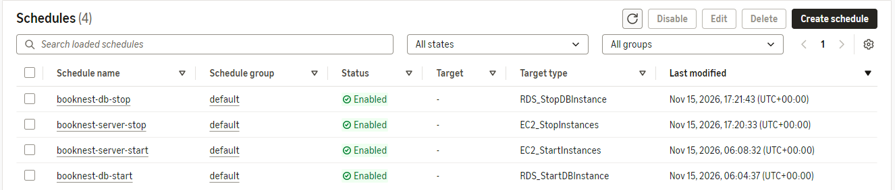

The containers use `restart: unless-stopped`, so they come back by themselves when the server starts.

### Security summary

* RDS is private and accepts only the server's security group; it is never open to the internet.
* Only port 80 is public; SSH and pgAdmin are limited to one IP address (plus AWS's own range for EC2 Instance Connect).
* Secrets (database password, JWT secret, email password) exist only in the server's `.env` and in Jenkins
  credentials, never in Git. `.env` is in `.gitignore`.
* No AWS access keys: the server uses an IAM role, the scheduler uses a role limited to start/stop of two resources.
* Containers run as a non-root user, with a memory limit each. Error replies in production never include stack traces.


## 6. Deploy

### Automatic: Jenkins

Jenkins runs in Docker on a laptop ([jenkins/](../jenkins)), with Java 17, the Docker CLI and the plugins the
pipeline needs:

```bash
docker compose -f jenkins/docker-compose.yml up -d --build
```

It is on http://localhost:8090, with a Multibranch Pipeline job on the GitHub repository. GitHub cannot reach
the laptop, so Jenkins checks for new commits every 2 minutes (`pollSCM`).

Jenkins credentials (never in the code):

| Id | Kind | For |
|---|---|---|
| `dockerhub` | username + access token | pushing the images |
| `ec2-ssh` | SSH username (`ec2-user`) with private key | deploying to the server |

The pipeline ([Jenkinsfile](../Jenkinsfile)):

```
git push
  → Build          ./mvnw clean package -DskipTests
  → Test           ./mvnw test (every service's Cucumber scenarios; reports kept on the build page)
  → Build images   (main only) three tags per service: 1.1.0, 1.1.0-<commit>, latest
  → Push images    (main only) to Docker Hub
  → Deploy         (main only) over SSH to the server
```

Every other branch and pull request stops after the tests. Any failing step makes the build red and stops it,
so nothing untested is deployed.

The Deploy stage:

1. copies `docker-compose.prod.yml` to `~/booknest` on the server;
2. sets `VERSION=<version>-<commit>` in the server's `.env`, so the server runs exactly the images this build pushed;
3. runs `docker compose pull` and `docker compose up -d --wait --wait-timeout 300`, which fails the build if a
   service does not become healthy within 5 minutes;
4. removes old images (`docker image prune -f`);
5. requests the site from Jenkins with `curl`; if it does not answer, the build is red.

To release a new version: change the version in the poms (for example `1.1.0` → `1.2.0`), merge to `main`, and
Jenkins builds, tests, pushes and deploys it.

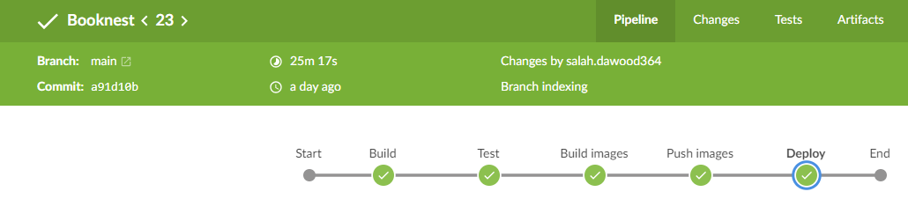

### Manual (on the server)

```bash
ssh -i ~/.ssh/booknest-key.pem ec2-user@<elastic-ip>
cd ~/booknest
docker compose -f docker-compose.prod.yml pull
docker compose -f docker-compose.prod.yml up -d
```

### Roll back

Set `VERSION` in the server's `.env` to an older tag (for example `1.0.0-15db897`) and run the two commands above.
Every earlier version is still on Docker Hub.

### pgAdmin on the server

Off by default, so deploys never start it:

```bash
docker compose -f docker-compose.prod.yml --profile admin up -d pgadmin
```

Open `http://<elastic-ip>:5050` (allowed only from my IP); the RDS database is already listed. Stop it with
`docker compose -f docker-compose.prod.yml --profile admin stop pgadmin`.


## 7. Verify the deployment

1. Jenkins: the build of `main` is green, including the Deploy stage and the final `curl`.
2. On the server, every container is running and healthy, with two lending-service containers:

   ```bash
   docker compose -f docker-compose.prod.yml ps
   ```

   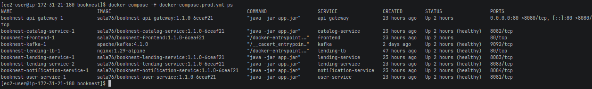

3. The site opens at `http://<elastic-ip>` and the version at the bottom of the side menu is the new one; the
   same version is at `http://<elastic-ip>/actuator/info`. `http://<elastic-ip>/actuator/health` answers `UP`.

   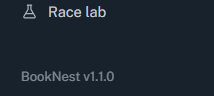
4. Log in, borrow and return a book; the live notification and the email arrive (this checks Kafka and
   notification-service).
5. Both lending instances answer: the `X-Lending-Instance` header of `/api/loans/...` replies alternates between two addresses.
6. The race test passes against the server: exactly one borrow of the last copy succeeds.

   ```bash
   python3 scripts/race-test.py --url http://<elastic-ip>
   ```

   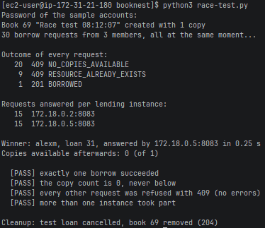

7. CloudWatch Logs shows fresh log streams in `/booknest/prod` for every container (see [MONITORING.md](MONITORING.md)).
