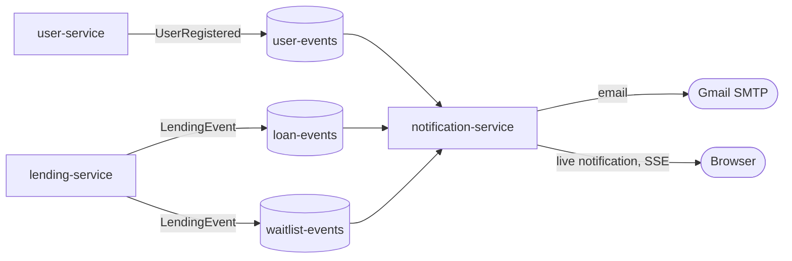

# Kafka

Kafka carries everything that tells people what happened: emails and live notifications. The services that
change data (user-service, lending-service) publish an event and carry on; notification-service reads the
events and does the slow, failure-prone work (talking to the mail server, pushing to browsers).

Borrowing, returning or registering never waits for an email. If notification-service or Gmail is down,
those actions still work, and the notifications go out once it is back.



Kafka runs as one broker in KRaft mode (no ZooKeeper), image `apache/kafka:4.1.0`, in Docker locally and on
the EC2 server. Services find it through `KAFKA_BOOTSTRAP_SERVERS` (`kafka:9092` inside Docker).


## Topics

| Topic | Partitions | Producer | Consumer (group `notification-service`) | Key |
|---|---|---|---|---|
| `user-events` | 3 | user-service | notification-service | user id |
| `loan-events` | 3 | lending-service | notification-service | member's user id |
| `waitlist-events` | 3 | lending-service | notification-service | member's user id |
| `user-events.DLT`, `loan-events.DLT`, `waitlist-events.DLT` | 3 | notification-service (failed events) | none, kept for inspection | same as the original |

The key is the member's id, so all events of one member land on the same partition and are handled in order.
The topics are created on startup by whichever service starts first, so the start order does not matter.


## Events

Events are JSON. The producer and consumer each have their own Java record for the event; they share the JSON
shape, not a class.

### UserRegistered (topic `user-events`)

Published by user-service when an account is created, by registration or by a librarian.

```json
{
  "eventId": "6f1c2a0e-8a3b-4c51-9a55-0c8e1f3b2d47",
  "userId": 12,
  "username": "janed",
  "email": "janed@example.com",
  "occurredAt": "2026-11-16T10:15:30"
}
```

When it is received: notification-service saves (or overwrites) the recipient `id, username, email` in its
`recipients` table. That is how it knows where to send a member's emails without calling user-service.

### LendingEvent (topics `loan-events` and `waitlist-events`)

Published by lending-service, only after the database transaction that caused it has committed
(`TransactionUtils.afterCommit`), so nothing is announced for a change that was rolled back.

```json
{
  "eventId": "b0d6e0c4-2f6b-4d0e-9a1e-3c7d5a9f8e21",
  "type": "HOLD_READY",
  "audience": "MEMBER",
  "userId": 12,
  "username": "janed",
  "loanId": null,
  "status": null,
  "message": "A copy of \"Dune\" is held for you for 24 hours. Claim it before it expires",
  "occurredAt": "2026-11-16T10:20:02"
}
```

`audience` is `MEMBER` (the member gets an email and a live notification) or `LIBRARIANS` (every logged-in
librarian gets a live notification, no email).

| Type | Topic | Audience | When |
|---|---|---|---|
| `LOAN_RETURNED` | loan-events | LIBRARIANS | a member returns a book; it now waits for a librarian's review |
| `LOAN_RETURNED` | loan-events | MEMBER | a librarian records the return for the member |
| `RETURN_REVIEWED` | loan-events | MEMBER | a librarian reviewed the return (with a damage fine, if any) |
| `LOAN_CANCELLED` | loan-events | MEMBER | a librarian cancelled the member's loan |
| `DUE_TOMORROW` | loan-events | MEMBER | the daily reminder job, for every loan due tomorrow |
| `HOLD_READY` | waitlist-events | MEMBER | a copy came back and is held for the first member in line |
| `HOLD_EXPIRED` | waitlist-events | MEMBER | the member did not claim the held copy in time; it goes to the next in line |

When it is received (`EventListener.onLendingEvent`):

1. If `eventId` is already in `processed_events`, the event was handled before and is skipped.
2. For `MEMBER`: the email address is looked up in `recipients` and the email is sent on the
   `notificationExecutor` thread pool; the listener waits for the result. Then the live notification is pushed
   to the member's open browser tabs over Server-Sent Events.
3. For `LIBRARIANS`: the live notification is pushed to every connected librarian.
4. The `eventId` is saved in `processed_events`.

The daily `DUE_TOMORROW` job sends all its events at once and waits for Kafka to confirm every one
(`CompletableFuture.allOf`), then logs how many were sent and how many failed.


## Reliability

| Situation | What happens |
|---|---|
| notification-service is down or restarting | Events stay in Kafka. The consumer group remembers its position (offset), so when the service comes back it continues where it stopped; nothing is lost. A brand-new group starts from the oldest event (`auto-offset-reset=earliest`). |
| An event is delivered twice | Each event has a unique `eventId`. Lending events are recorded in `processed_events` after they are handled, and a repeated id is skipped, so no second email. `UserRegistered` simply overwrites the same recipient row, which is harmless. |
| Handling fails (for example Gmail refuses) | The listener throws, and the event is tried again 3 more times, 2 seconds apart (`DefaultErrorHandler`, `FixedBackOff(2000, 3)`). The live notification is pushed only after the email succeeded, so a retry never shows the same pop-up twice. |
| It still fails after the retries | The event is moved to its dead-letter topic (`<topic>.DLT`, same partition) and logged with topic, partition and offset. The events behind it are not blocked. |
| The event is not valid JSON | It goes to the dead-letter topic straight away; retrying cannot fix it. |
| Events arrive faster than they are handled | They wait in Kafka, not in memory. The listener runs 3 consumer threads (one per partition), and emails go through a pool of 4–8 threads with a queue of 100; when the queue is full the listener thread sends the email itself (`CallerRunsPolicy`), which slows consumption down instead of dropping emails. |
| A producer sends while the broker blips | Producers use `acks=all` and idempotence, so a retried send is not stored twice. |

### Assumptions and limitations

* One Kafka broker (replication factor 1). If the broker's disk is lost, unconsumed events are lost. A real
  production setup would run three brokers.
* If Kafka is down when an event is published, the producer gives up after 5 seconds (`max.block.ms`), logs the
  error, and the loan or account change still succeeds; that one notification is lost. An outbox table would fix
  this and was left out to keep the design simple.
* Events in a dead-letter topic are not replayed automatically; they are there to be inspected (see
  [MONITORING.md](MONITORING.md)).
* A member who never had a `UserRegistered` event handled (for example accounts created before Kafka was
  added) gets live notifications but no emails, because there is no email address to use.
* An event can be handled twice in one rare case: the email is sent, then the service crashes before the
  `eventId` is saved. Kafka redelivers it and the email goes out again. Sending the email and saving the id cannot
  be one transaction, so this is accepted.


## Where to look

* Producer: `user-service/.../event/UserEventPublisher.java`, `lending-service/.../event/LendingEventPublisher.java`
* Consumer: `notification-service/.../event/EventListener.java`
* Topics and error handling: `notification-service/.../config/KafkaConfig.java`
* Kafka settings: `spring.kafka.*` in each service's `application.properties`
* Tests: the Kafka scenarios in each service's Cucumber features run against an embedded Kafka broker
  (see [TESTING.md](TESTING.md)).
