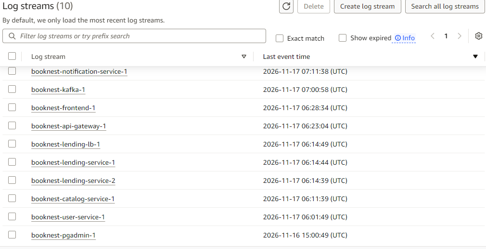

# Monitoring and logging

How to see what BookNest is doing and find out why something failed: locally with Docker, and on AWS with
CloudWatch Logs.


## What the services log

Every service logs the business actions it performs, with the ids needed to follow one action through the system.

| Service | Examples |
|---|---|
| lending-service | `Borrow started: user=12 book=7 days=14`, `Borrow completed: loan=88 user=12 book=7 copiesLeft=0 in 41 ms`, `Return registered`, `Return reviewed`, `Hold claimed`, `Fine 5 paid by janed` |
| lending-service jobs | `Hold expiry started for 2 hold(s)` / `finished in 35 ms: 2 expired, 0 skipped, 0 failed`, `Due reminders started for 3 loan(s)` / `finished in 120 ms: 3 sent, 0 failed` |
| catalog-service | `Book 51 created with 3 copies`, `lending-service is not reachable: ...` |
| notification-service | `Email 'BookNest - A copy is ready for you' for janed sent in 950 ms on thread notify-2`, `User janed opened a notification stream` |
| lending-lb (nginx) | `172.18.0.9 "POST /api/loans HTTP/1.1" 201 -> 172.18.0.6:8083 in 0.045 s`, showing which lending-service copy answered |
| every service | refused requests with their error code (`Request refused: POST /api/loans by janed -> NO_COPIES_AVAILABLE: ...`), failed logins, invalid tokens, and unexpected errors with their stack trace |

Kafka activity:

| Where | Log line |
|---|---|
| producer (lending-service) | `Published HOLD_READY event b0d6e0c4-... to waitlist-events`, or `Could not publish ... ` when Kafka is unreachable |
| producer (user-service) | `Could not publish UserRegistered for user 12: ...` when Kafka is unreachable |
| consumer (notification-service) | `Recipient janed saved from UserRegistered event ...`, `Event b0d6e0c4-... (HOLD_READY) for janed` |
| consumer, duplicate | `Event b0d6e0c4-... was already handled, skipped` |
| consumer, failure | `Email '...' for janed failed on thread ...`, then after the retries `Event from loan-events (partition 1, offset 42) failed and was moved to loan-events.DLT: ...` |
| consumer start | Spring Kafka's `partitions assigned: [loan-events-0, ...]` |

No passwords, tokens or email contents are logged.


## Health checks

| Check | Where |
|---|---|
| `/actuator/health` on every Spring Boot service | used by Docker's health checks; `docker compose ps` shows `healthy` or `unhealthy` |
| `http://<host>/actuator/health` | the gateway's health, from outside |
| `http://<host>/actuator/info` | the running version, for example `{"build":{"version":"1.1.0",...}}` |
| `/lb-health` on `lending-lb` | the load balancer's own health check |
| Kafka | `kafka-broker-api-versions.sh` as its health check |

Services that depend on others start only when those are healthy, and the Jenkins deploy waits up to
5 minutes for every container to be healthy (`--wait`) or the build fails.


## Locally (Docker)

```bash
docker compose ps
```
State and health of every container.

```bash
docker compose logs -f lending-service
```
Follow one service's logs (leave out the name for all of them).

```bash
docker compose logs --since 10m notification-service | grep -i "failed\|error"
```
Recent problems of one service.

```bash
docker stats
```
Memory and CPU of each container.


## On AWS: CloudWatch Logs

Every container in `docker-compose.prod.yml` uses Docker's `awslogs` log driver:

* log group `/booknest/prod` in `us-east-1`;
* one log stream per container, named after it, for example `booknest-lending-service-1`,
  `booknest-lending-service-2`, `booknest-kafka-1`;
* the server writes with its IAM role `booknest-ec2-role`, so there are no AWS keys on the server;
* `mode: non-blocking`: if CloudWatch cannot be reached, log lines wait in a 4 MB buffer instead of slowing the service down.



### Reading the logs

* **Log streams:** CloudWatch, then Log groups, then `/booknest/prod`, then a stream: one container's log.
* **Live Tail:** CloudWatch, then Live Tail, then `/booknest/prod`: every container's log as it happens,
  with an optional filter such as `Borrow` or `ERROR`.
* **Logs Insights:** CloudWatch, then Logs Insights, then `/booknest/prod`, then one of the queries below.

### Logs Insights queries

Errors and warnings of the last hour, newest first:

```
fields @timestamp, @logStream, @message
| filter @message like /ERROR|WARN/
| sort @timestamp desc
| limit 100
```

Which lending-service copy answered each request (load balancing):

```
fields @timestamp, @message
| filter @logStream like /lending-lb/ and @message like /->/
| parse @message '-> * in' as instance
| stats count(*) as requests by instance
```

Borrows and how long they took:

```
fields @timestamp, @logStream, @message
| filter @message like /Borrow completed/
| parse @message 'copiesLeft=* in * ms' as copiesLeft, ms
| sort @timestamp desc
```

Kafka: events published and handled:

```
fields @timestamp, @logStream, @message
| filter @message like /Published|Event .* for|moved to/
| sort @timestamp desc
```

Emails sent and failed:

```
fields @timestamp, @message
| filter @logStream like /notification/ and @message like /Email/
| sort @timestamp desc
```

Which instance ran the scheduled jobs (ShedLock lets only one of the two lending-service copies run each job):

```
fields @timestamp, @logStream, @message
| filter @message like /Hold expiry finished|Due reminders finished/
| sort @timestamp desc
```


## Finding a failure

| Symptom | Where to look |
|---|---|
| The site does not open | `docker compose -f docker-compose.prod.yml ps` on the server: a container is restarting or unhealthy. Its stream in CloudWatch shows why (for example the database cannot be reached). |
| A page shows "service unavailable" | the gateway or catalog log: which service was not reachable. `lending-service is not reachable` means both lending copies are down. |
| A container keeps restarting | `docker inspect --format '{{.State.OOMKilled}}' <container>` shows if it ran out of memory; `docker stats` shows memory use. |
| No email arrived | notification-service stream: `Email ... sent`, `failed`, or `skipped, no email address`. If nothing is there, check the lending-service stream for `Published ...` and the notification-service stream for `moved to ... .DLT`. |
| Events seem stuck | the consumer group's lag (below). |

Kafka consumer group lag (events waiting to be handled) and the dead-letter topics, on the server:

```bash
docker compose -f docker-compose.prod.yml exec kafka /opt/kafka/bin/kafka-consumer-groups.sh --bootstrap-server localhost:9092 --describe --group notification-service
```

```bash
docker compose -f docker-compose.prod.yml exec kafka /opt/kafka/bin/kafka-console-consumer.sh --bootstrap-server localhost:9092 --topic loan-events.DLT --from-beginning --timeout-ms 5000
```

`LAG` is the number of events not handled yet; it should go back to 0.
