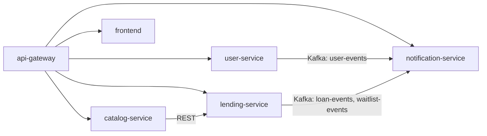

# Services

BookNest is split by business responsibility: who the people are (user-service), what the library owns
(catalog-service), what happens to the copies (lending-service), and telling people about it
(notification-service). In front of them sits api-gateway, and the web pages are their own frontend service.

Every service is its own Spring Boot application in its own Maven module, with its own configuration,
Dockerfile, dependencies and API. No service uses another service's Java classes; they talk only over
REST or Kafka.

| From | To | How | Why |
|---|---|---|---|
| browser | api-gateway | REST (sync) | the only public entrance |
| api-gateway | every service | REST (sync) | routes each path to the service that owns it |
| catalog-service | lending-service | REST (sync) | copy counts for the book pages, create/change/remove the stock of a book, "did this member return the book?" before a review |
| user-service | notification-service | Kafka (async) | `UserRegistered`: who the member is and the email to write to |
| lending-service | notification-service | Kafka (async) | loan, return, waitlist, hold and due-tomorrow events become emails and live notifications |

Catalog needs the answer right away to show a page or save a book, so it calls lending directly.
Notifications are not needed to finish a borrow, so lending only publishes an event and moves on
(see [KAFKA.md](KAFKA.md)).

## Security across services

* user-service checks the password and signs a JWT holding the user id, username and role (`Member` or `librarian`).
* Every other service checks the JWT itself with the same secret (`JWT_SECRET`) and applies its own role rules
  (`@PreAuthorize("hasRole('librarian')")`). No service calls user-service to check a token.
* When catalog-service calls lending-service it sends the caller's own token along, so lending applies the same
  rules as if the user had called it.

Access used in the tables below: Public = no token, User = any logged-in user, Librarian = librarian only.

## Data ownership

All services use one PostgreSQL database, `booknest` (Amazon RDS on AWS), with every table in the `public` schema.
Each service reads and writes only the tables it owns; nothing joins across services.

| Service | Tables | What other services get, and how |
|---|---|---|
| user-service | `users`, `profiles` | the user id, username and role travel in the JWT; the email travels in the `UserRegistered` event |
| catalog-service | `books`, `authors`, `genres`, `books_genres`, `reviews` | lending keeps the book id and a copy of the title, sent when the stock is created |
| lending-service | `inventory`, `loans`, `waitlist_entries`, `fines`, `members`, `audit_logs`, `shedlock` | catalog asks for copy counts and returned loans over REST; notification gets events |
| notification-service | `recipients`, `processed_events` | nothing, it only receives |

Where a service needs data it does not own, it keeps a small copy of what it needs instead of reading the other
service's tables:

* lending's `members` (id, username) is created from the JWT on a member's first lending request. Lending
  locks this row to enforce the 5-loan limit.
* lending's loans and waitlist entries keep the `username` and `bookTitle` next to the ids, so lists can be
  shown without calling other services.
* notification's `recipients` (id, username, email) is filled from `UserRegistered` events, so it can address
  emails without calling user-service.

Limitation: a book's title is copied when its stock is created; renaming the book later does not update the
copy in lending.

## api-gateway (port 8080, 80 on AWS)

Spring Cloud Gateway (Web MVC). The only service with a public port. It holds no data and no business rules.

| Path | Goes to |
|---|---|
| `/auth/users/**`, `/auth/email/**`, `/api/member/**`, `/api/librarian/**`, `/profile/**` | user-service |
| `/api/books/**`, `/api/authors/**`, `/api/genres/**`, `/api/reviews/**` | catalog-service |
| `/api/loans/**`, `/api/fines/**`, `/api/waitlist/**`, `/api/inventory/**`, `/api/audit-log/**`, `/api/demo/**` | lending-service (on AWS: the `lending-lb` load balancer) |
| `/api/notifications/**` | notification-service |
| `/`, `/index.html`, `/css/**`, `/js/**` | frontend |

The address of each service comes from an environment variable (`USER_SERVICE_URL`, `CATALOG_SERVICE_URL`,
`LENDING_SERVICE_URL`, `NOTIFICATION_SERVICE_URL`, `FRONTEND_URL`). The gateway passes the client's IP on,
so the login rate limit in user-service counts each user's own IP.

Own endpoints: `/actuator/health`, `/actuator/info` (shows the version).

## frontend (port 3000 locally, 80 inside the container)

Plain HTML, CSS and JavaScript served by nginx. The browser loads it through the gateway, so the pages and the
API share one address. Pages: catalogue (bookshelf), my loans / waitlist / fines, librarian admin pages,
and the Race lab.

## user-service (port 8081)

**Responsibility:** who the users are. Registration, login, email verification, password reset, profiles,
and account administration by librarians.

**Data:** `users` (username, email, password hash, role, active, verified), `profiles` (name, bio, age, picture).
Profile pictures are files in the `profile-images` Docker volume, served at `/profile/**`.

**Talks to:** publishes `UserRegistered` to Kafka topic `user-events` when an account is created (by
registration or by a librarian). Sends verification and password-reset emails itself through Gmail SMTP,
because those are part of signing in, not notifications. A Bucket4j filter limits `/auth/**` calls per IP.

| Method | Endpoint | Description | Access |
|---|---|---|---|
| POST | `/auth/users/register` | register a member | Public |
| POST | `/auth/users/login` | log in, returns a JWT | Public |
| PUT | `/auth/users/passwordreset/{token}` | set a new password with the emailed token | Public |
| PUT | `/auth/email/getverification/{username}` | email a verification code | Public |
| PUT | `/auth/email/verify/{username}?code=` | verify the email with the code | Public |
| PUT | `/auth/email/forgotpassword` | email a password-reset link | Public |
| GET | `/api/member/profile` | my profile | User |
| PUT | `/api/member/update/profile` | update my profile (multipart, optional picture) | User |
| PUT | `/api/member/change-password` | change my password | User |
| GET | `/api/librarian/users` | all users | Librarian |
| GET | `/api/librarian/users/{userId}` | one user | Librarian |
| POST | `/api/librarian/users` | create a librarian account (verified at once) | Librarian |
| PUT | `/api/librarian/users/deactivate/{userId}` | deactivate an account | Librarian |
| PUT | `/api/librarian/users/activate/{userId}` | activate an account | Librarian |

Swagger UI: http://localhost:8081/swagger-ui/index.html (when the service runs from IntelliJ).

## catalog-service (port 8082)

**Responsibility:** what the library has. Books, authors, genres and reviews.

**Data:** `books` (title, ISBN, year, author), `authors`, `genres`, `books_genres` (book ↔ genre), `reviews`
(rating, comment, member).

**Talks to:** lending-service over REST, with a 2 s connect and 5 s read timeout
(`lending-service.connect-timeout`, `lending-service.read-timeout`):

| Call to lending | When |
|---|---|
| `GET /api/inventory?bookIds=1,2,3` | every book list or book page, to show copy counts |
| `POST /api/inventory` | a librarian adds a book; if lending refuses or is down, the new book is removed again, so no book exists without stock |
| `PUT /api/inventory/{bookId}` | a librarian changes the number of copies |
| `DELETE /api/inventory/{bookId}` | a librarian deletes a book; lending refuses while a copy is out or a return waits for review |
| `GET /api/loans/returned/{bookId}` | a member writes a review; only members who returned the book may review it |

If lending-service answers with an error, catalog passes on the same kind of error (400, 404, 409 with its
message); if lending is down or too slow, the caller gets 503.

| Method | Endpoint | Description | Access |
|---|---|---|---|
| GET | `/api/books` | books, paged; params `title`, `genre`, `page`, `size`, `sortBy`, `sortDir` | User |
| GET | `/api/books/{bookId}` | one book with copies and rating | User |
| GET | `/api/books/search/{title}` | a book by exact title | User |
| POST | `/api/books` | add a book with its number of copies | Librarian |
| PUT | `/api/books/{bookId}` | change a book | Librarian |
| DELETE | `/api/books/{bookId}` | delete a book | Librarian |
| GET | `/api/authors` | all authors | User |
| GET | `/api/authors/{authorId}` | one author | User |
| GET | `/api/authors/search/{name}` | an author by exact name | User |
| POST / PUT / DELETE | `/api/authors`, `/api/authors/{authorId}` | manage authors | Librarian |
| GET | `/api/genres` | all genres | User |
| GET | `/api/genres/{name}` | a genre by exact name | User |
| POST / PUT / DELETE | `/api/genres`, `/api/genres/{genreId}` | manage genres | Librarian |
| GET | `/api/books/{bookId}/reviews` | reviews and average rating | User |
| POST | `/api/books/{bookId}/reviews` | review a returned book (`rating`, `comment`) | User |
| PUT | `/api/reviews/{reviewId}` | change my review | User |
| DELETE | `/api/reviews/{reviewId}` | delete my review | User |

Swagger UI: http://localhost:8082/swagger-ui/index.html

## lending-service (port 8083)

**Responsibility:** what happens to the copies. Stock, borrowing, returns and their review, the waitlist and
holds, fines, the audit log, and the scheduled jobs (hold expiry every minute, due-tomorrow reminders daily).
This is where the concurrency rules live (see the README).

**Data:** `inventory` (book id, title, total and free copies), `loans`, `waitlist_entries`, `fines`,
`members` (id, username), `audit_logs` (loan, fine and waitlist actions), `shedlock` (which instance runs a job).

**Talks to:** publishes events to Kafka topics `loan-events` and `waitlist-events`, only after the database
transaction commits. Answers catalog-service's REST calls. On AWS it runs as two instances behind the nginx
load balancer `lending-lb`; ShedLock makes sure each scheduled job runs on only one of them.

| Method | Endpoint | Description | Access |
|---|---|---|---|
| POST | `/api/loans` | borrow a book (`bookId`, `duration` in days) | User |
| GET | `/api/loans/my-loans` | my loans | User |
| GET | `/api/loans/my-stats` | my return record (on time, early, late) | User |
| PUT | `/api/loans/{loanId}/return` | return a book; it waits for a librarian's review | User |
| GET | `/api/loans/returned/{bookId}` | did I return this book? (used by catalog) | User |
| GET | `/api/loans?status=` | all loans | Librarian |
| GET | `/api/loans/user/{userId}` | a member's loans | Librarian |
| GET | `/api/loans/user/{userId}/stats` | a member's return record | Librarian |
| GET | `/api/loans/returns-review` | returns waiting for review | Librarian |
| PUT | `/api/loans/{loanId}/review-return` | review a return (`damaged`, `notes`, `fineAmount`) | Librarian |
| PUT | `/api/loans/{loanId}/cancel` | cancel a loan that is still out | Librarian |
| POST | `/api/waitlist` | join the waitlist of a book | User |
| GET | `/api/waitlist/my` | my waitlist entries | User |
| GET | `/api/waitlist/{entryId}` | one entry with its place in line | User |
| DELETE | `/api/waitlist/{entryId}` | leave the waitlist | User |
| POST | `/api/waitlist/{entryId}/claim?days=` | borrow the copy held for me | User |
| GET | `/api/waitlist/book/{bookId}` | the line for a book | Librarian |
| GET | `/api/fines/my-fines` | my fines | User |
| PUT | `/api/fines/{id}/pay` | pay a fine | User |
| GET | `/api/fines` | all fines | Librarian |
| GET | `/api/fines/user/{id}` | a member's fines | Librarian |
| GET | `/api/inventory?bookIds=` | copy counts of books (used by catalog) | User |
| POST / PUT / DELETE | `/api/inventory`, `/api/inventory/{bookId}` | stock of a book (called by catalog) | Librarian |
| GET | `/api/audit-log?type=&userId=` | the audit log | Librarian |
| POST | `/api/demo/race/{bookId}?threads=&safe=` | last-copy race demo (`race-demo` profile) | Librarian |
| POST | `/api/demo/race/loan-limit/{username}?threads=&safe=` | loan-limit race demo (`race-demo` profile) | Librarian |

Conflicts answer `409` with a code such as `NO_COPIES_AVAILABLE`, `LOAN_LIMIT_REACHED`, `NO_ACTIVE_HOLD`,
`HOLD_EXPIRED`, `FINE_ALREADY_PAID` or `CONCURRENT_UPDATE`.

Swagger UI: http://localhost:8083/swagger-ui/index.html

## notification-service (port 8084)

**Responsibility:** telling people what happened. Turns events into emails and live notifications in the browser.

**Data:** `recipients` (user id, username, email, filled from `UserRegistered`), `processed_events` (ids of
events already handled, so a repeated event is skipped).

**Talks to:** consumes `user-events`, `loan-events` and `waitlist-events` from Kafka; sends emails through
Gmail SMTP on its own thread pool; pushes live notifications over Server-Sent Events to members, or to every
logged-in librarian for librarian events. It never calls another service. Details in [KAFKA.md](KAFKA.md).

| Method | Endpoint | Description | Access |
|---|---|---|---|
| GET | `/api/notifications/stream` | live notifications (Server-Sent Events) | User |

## Health and version

Every Spring Boot service has `/actuator/health`, used by the Docker health checks. The gateway also has
`/actuator/info`, which shows the build version (the one at the bottom of the site's side menu).
See [MONITORING.md](MONITORING.md).
