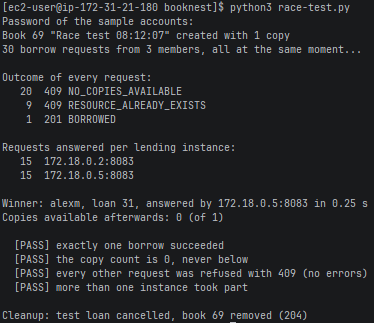

# Testing

All automated tests are Cucumber (BDD) scenarios: Gherkin feature files with Given / When / Then steps,
run by JUnit Platform. Every service has its own suite and runs on its own; no service's tests need another
service, PostgreSQL or a real Kafka.

| Service | Scenarios | Feature files |
|---|---|---|
| api-gateway | 31 | health, routing |
| user-service | 51 | registration, login, email verification, password reset, member account, user administration, create librarian, Kafka events, health |
| catalog-service | 29 | books, reviews, talking to lending-service, health |
| lending-service | 75 | borrowing, returns and reviews, waitlist and holds, concurrency, scheduled jobs, Kafka events, configuration, health |
| notification-service | 20 | Kafka notifications, Kafka reliability, live notifications, health |
| **Total** | **206** | |

(Scenario Outlines count once per example row.)


## How the tests run

* Each suite starts the real Spring Boot application on a random port, with the `test` profile, and calls
  its real REST API over HTTP, the same way the gateway does.
* The database is in-memory H2, so the tests never touch the local PostgreSQL or RDS.
* user-, lending- and notification-service start an embedded Kafka broker (`@EmbeddedKafka`), so publishing
  and consuming are tested with a real Kafka client.
* Where a service talks to another service, the other one is replaced by a small fake HTTP server:
  catalog-service talks to a fake lending-service, and the gateway routes to fake services. The fakes can be
  told to fail, be slow or be down.
* Emails go to a fake mail sender that keeps them in memory, so scenarios can check what was sent, and can
  make the mail server fail.
* Each scenario sets up the data it needs (books, copies, members) in its Given steps.

Where the code is:

```
<service>/src/test/resources/features/*.feature     the scenarios
<service>/src/test/java/.../cucumber/                the step definitions, fakes and the suite class
```


## Running them

All services:

```bash
./mvnw test
```

One service:

```bash
./mvnw -pl lending-service test
```

Each run writes an HTML report to `<service>/target/cucumber-report.html`. In IntelliJ, a single feature file
or scenario can be run from the green arrow next to it.

Jenkins runs `./mvnw test` on every push. A failing scenario makes the build red and stops it before any image is
built or deployed. The build page shows the results, and each service's Cucumber report is kept as a build artifact.


## What is covered

| Area | Examples |
|---|---|
| Microservice APIs | registering, logging in, borrowing, returning, reviewing, waitlists, fines, admin pages; the right status codes and error codes for every refusal (`409 NO_COPIES_AVAILABLE`, `403` for members on librarian pages, `401` without a login) |
| Service-to-service communication | catalog creates and changes stock in lending, passes the caller's token on, answers 503 when lending is down or too slow and recovers when it is back; the gateway sends each path to the right service, passes the method, token, body and caller IP on, and keeps working when one service is down |
| Kafka event publishing | a registration publishes `UserRegistered`; each loan and waitlist action publishes the right event to the right topic; a refused action or a rolled-back change publishes nothing |
| Kafka event consumption and reliability | each event type sends the right email; librarian events send no email; a duplicate event sends one email; a failing mail server is retried, then the event goes to the dead-letter topic without blocking the next events; invalid JSON goes straight to the dead-letter topic |
| Live notifications | a member's event reaches only that member's stream, a librarian event reaches librarians only, and the pop-up comes only after the email went out |
| Concurrency | 10 members racing for the last copy (1 wins, 9 get `NO_COPIES_AVAILABLE`), double-clicks, the 5-loan limit, no deadlock with requests in different orders, return vs cancel, two librarians reviewing one return, one fine paid 5 times, waitlist joins, claims and expiries at the same moment |
| Several instances | two lending-service schedulers sharing one database: ShedLock lets only one run each job |
| Configuration | the tests run on the `test` profile with H2; sample data and the race demo are on only where they should be; library rules such as the late fine per day and the hold length come from the configuration |
| Health endpoints | every service answers `UP` on `/actuator/health`; the gateway answers its own health and shows the version on `/actuator/info` |

Concurrency scenarios release all their requests at the same instant (threads waiting on one latch) against the
real REST API, then check the results and that the stock adds up:

```gherkin
Scenario: 10 members race for the last copy, only one gets it
  Given the library has 1 copies of "Clean Code"
  When 10 different members try to borrow "Clean Code" at the same moment
  Then exactly 1 of them succeeded
  And 9 of them were refused with "NO_COPIES_AVAILABLE"
  And 1 member has "Clean Code" on loan
  And "Clean Code" has 0 of 1 copies on the shelf
  And the shelf count of "Clean Code" adds up
```


## Testing the deployed application: the race test

The Cucumber suites test each service on its own. `scripts/race-test.py` tests the real, containerized system,
locally or on AWS, through the gateway and the load balancer, with both lending-service instances running:

1. the librarian creates a throwaway book with exactly 1 copy;
2. every sample member sends a borrow request for it at the same moment; `lending-lb` spreads them over both
   lending-service instances;
3. exactly one borrow must succeed, every other one must be refused, and the copy count must end at 0;
4. the test loan and the book are removed again (unless `--keep`).

It needs only Python 3:

```bash
python3 scripts/race-test.py --url http://<elastic-ip>
```

On the server itself, `--url` can be left out (it defaults to http://localhost). The password of the sample accounts is
asked for, or read from `BOOKNEST_PASSWORD`. It prints which instance answered each request (the `X-Lending-Instance` header
set by `lending-lb`), so the result shows that the rule held across both instances.



After a deploy, Jenkins also checks the containerized application: `docker compose up --wait` fails the build if
any container does not become healthy, and the site must answer from outside (see [DEPLOYMENT.md](DEPLOYMENT.md)).
